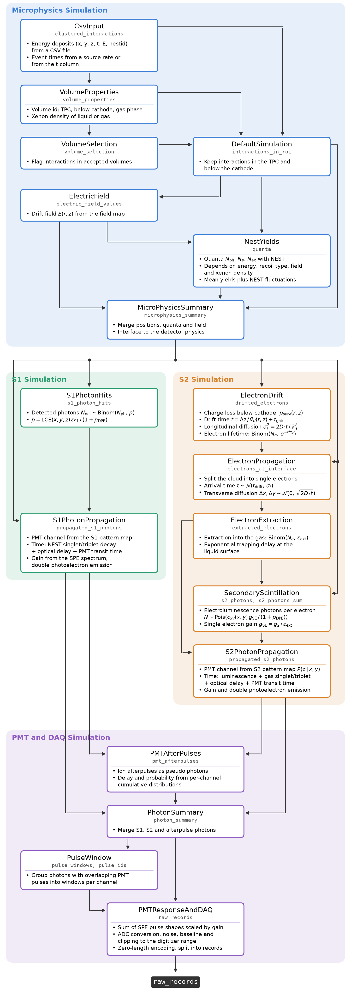

# ember

**E**vent **M**odelling **B**ridging **E**nergy deposits and **R**eadout

`ember` is a ligth weight tutorial software for full chain waveform simulations based on the `strax` framework. This software is inspired by XENONnT's `fuse` package, but is meant as a simplified standalone package that can be used as base to build more suffisticated simulation models for other experiments like the planned XLZD experiment.

`ember` utilizes the strax framework to to build a modular simulation structure that can be easily adjusted according to the users needs. It can be operated together with the `strax` based package `abstrax` which provides a simplified signal reconstruction platform based on XENONnT's reconstruction software `straxen`. `abstrax` follows the same phillosophy as `ember` and works as a standalone tutorial package. It also explains the nature of the `strax` framework and how to use it in more detail. 

`ember` and `abstrax` are not meant as development packages. You can use/fork these packages as starting point for your own project. Please only add bug fixes, or improvments that keep the tutorial nature of these two repositories.

When you work with `ember` or `abstrax` please cite [fuse](github.com/XENONnT/fuse) and [straxen](https://github.com/XENONnT/straxen) as reference.

# The package structure:

```
ember/
├── ember/                      the Python package
│   ├── config/detector.yaml    detector parameters (single source of truth)
│   ├── dummy_maps/             simple maps and tables: drift field and drift map, S1 and S2 light maps,
│   │                           S1 and S2 timing, PMT positions, SPE spectra, SPE pulse shape, noise,
│   │                           PMT afterpulses
│   ├── plugins/micro_physics/  CSV input → microphysics_summary
│   ├── plugins/detector_physics/  microphysics_summary → propagated_s1_photons, propagated_s2_photons
│   ├── plugins/pmt_and_daq/    photons → afterpulses, pulse windows → raw_records
│   ├── contexts.py             ember_context()
│   ├── benchmark.py            end-to-end benchmark (python -m ember.benchmark)
│   └── ...                     base plugin, dtypes, helpers, URL protocols, maps
├── map_generators/             notebooks that create the dummy maps
├── tutorials/                  tutorial notebooks
└── tests/unit/                 unit tests (pytest + hypothesis)
```

# Simulation overview:

The subsequent image shows the simulation step ember currently enables. The exact output is controlled via the provided dummy maps and NEST parameter defaults.




# Quick start

The default simulation config can be found in `config/detector.yaml`. It is a XENONnT/LZ sized detector (O(500), 1.5 m in diameter and height). A second file in `configs/xlzd_like_detector.yaml` can be used to change the simulation config to a XLZD-sized detector (O(2000) PMTs, 3 m in diameter and height). The simulation will always use the inputs from the `detector.yaml`, so if you want to switch just rename the file. In addition to the config file the simulation also requires a number of input maps. The repository contains some ipynb in `map_generators` to generate dummy inputs which should give some reasonable starting point. If you want to change the default detector you need to run the notebooks to regenerate the respective inputs, e.g. making sure that the pattern maps have the correct number of channels. The notebooks are loading the settings from `config/detector.yaml` to keep map generation and detector config consistent.

Small disclaimer: The code was ported with the assitance of Claude. I could not check everything line-by-line

```python
import ember

st = ember.ember_context(output_folder="./ember_data")
st.set_config({"input_file": "my_instructions.csv"})
microphysics_summary = st.get_df("000001", "microphysics_summary")
s1_photons = st.get_df("000001", "propagated_s1_photons")
s2_photons = st.get_df("000001", "propagated_s2_photons")
raw_records = st.get_array("000001", "raw_records")
```

The input is a CSV file with one row per interaction and the columns
`eventid, t, x, y, z, ed, nestid, A, Z, photons, electrons` (cm, ns, keV). `-1` in `ed`,
`photons` or `electrons` means "not given": missing quanta are calculated with NEST. See
`tutorials/tutorial_1_csv_input.ipynb` for a full introduction,
`tutorials/tutorial_2_s1_photon_propagation.ipynb` for the S1 simulation and
`tutorials/tutorial_3_s2_simulation.ipynb` for the S2 simulation (electron drift, extraction,
electroluminescence, S2 photons) and `tutorials/tutorial_4_pmt_and_daq.ipynb` for the PMT response and
DAQ (afterpulses, waveforms, `raw_records`) and the processing of the simulated data with abstrax.

**Use one run id per CSV file.** The name of the input file is not part of the lineage (as in fuse). A
second CSV file simulated with the same run id into the same storage folder loads the stored data of the
first file instead.

The dummy S1 optical timing map comes from a small optical toy Monte Carlo of the configured TPC
(`ember/optical_toy_mc.py`, optical parameters in `detector.yaml` from K. Böse's PhD thesis). Replace it
with the result of a full optical photon simulation of your detector if you have one (see
`map_generators/dummy_s1_timing_maps.ipynb`).

The S2 simulation uses dummy maps as well: a drift map from a constant drift field and NEST, a Gaussian
S2 hit pattern on the top array, a luminescence timing map for a mesh anode and an S2 optical timing map
from the toy Monte Carlo (`map_generators/dummy_field_maps.ipynb`, `dummy_s2_pattern_maps.ipynb`,
`dummy_s2_timing_maps.ipynb`). Tutorial 3 lists which of them to replace for a real detector.

The PMT and DAQ simulation uses a log-normal SPE pulse shape fitted to the published rise time, fall time
and width of the Hamamatsu R11410-10 and smeared with a normal distribution for the readout chain
(`pmt_pulse_smearing_sigma`), white Gaussian noise with the σ from `detector.yaml`, and He⁺, CH₄⁺
and Ar⁺ afterpulses with published delays and rates of the R11410-21 (`map_generators/dummy_pmt_pulse.ipynb`,
`dummy_noise.ipynb`, `dummy_pmt_afterpulses.ipynb`). Replace them with measurements of your PMTs and DAQ.

The ember context stops at `raw_records`. ember runs on its own; abstrax is an optional partner to process
the simulated data. Both packages read their detector settings with the same URLs (`detector://key`), so the
lineages are the same in both. Once ember is imported, `detector://` reads ember's `detector.yaml`, whatever the
import order, and the `[shared]` keys are identical in both files. abstrax's processing plugins can therefore
be added to the ember context:

```python
from abstrax.contexts import ABSTRAX_PLUGINS

st.register(ABSTRAX_PLUGINS)
st.set_config({"gain_model": "ember_pmt_to_pe://"})
event_info = st.get_df("000001", "event_info")
```

## Installation

```bash
pip install -e .              # ember alone
pip install -e ".[abstrax]"   # with abstrax to process the simulated raw_records
pip install -e ".[dev]"       # development tools
pytest                        # tests that need abstrax are skipped if it is not installed
```

## Benchmark

`python -m ember.benchmark` simulates beta events (40 keV, uniform in the TPC) from the CSV file to
`raw_records` and reports time, peak memory, rows and size on disk per plugin (`stages`) and for one run of
the whole chain (`total`). Data go to a temporary folder and are deleted afterwards.

```bash
python -m ember.benchmark --events 100 1000                 # CSV -> raw_records
python -m ember.benchmark --events 1000 --with-abstrax      # continue with abstrax to event_info
python -m ember.benchmark --csv my_instructions.csv --modes total --output results.json --report report.md
```

A warm-up run with 10 events comes first, so numba compilation is not measured (`--no-warmup` to include
it). The `stages` times include loading the stored inputs and writing every intermediate data type, so their
sum is larger than the `total` time. Peak memory per stage needs Linux (`/proc/self/clear_refs`).
